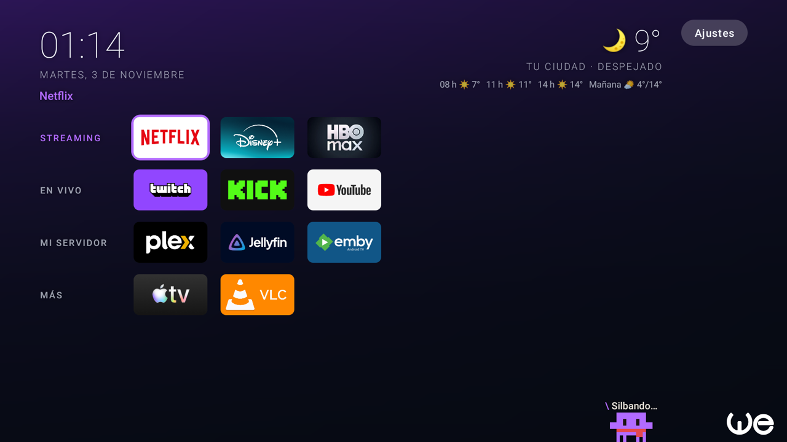
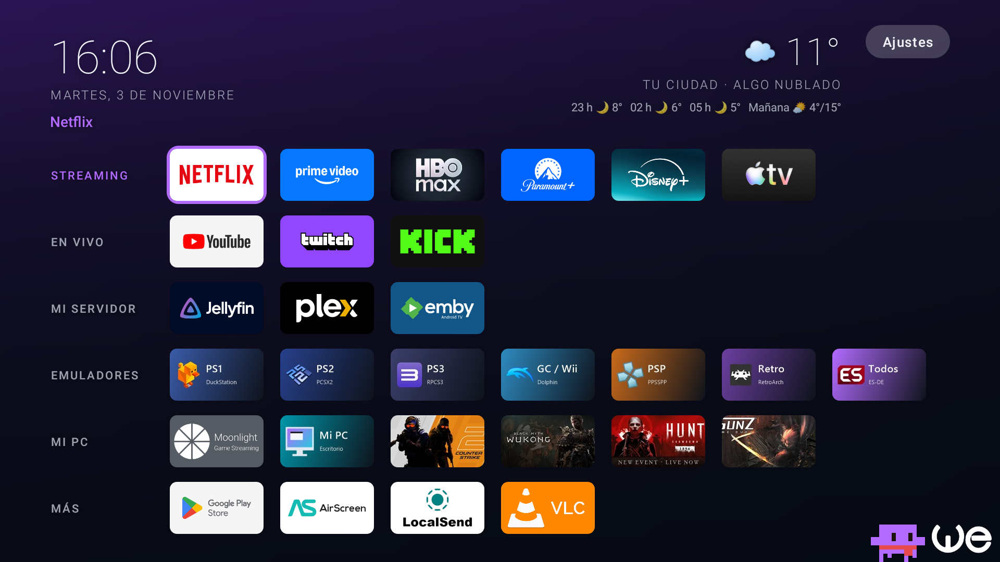
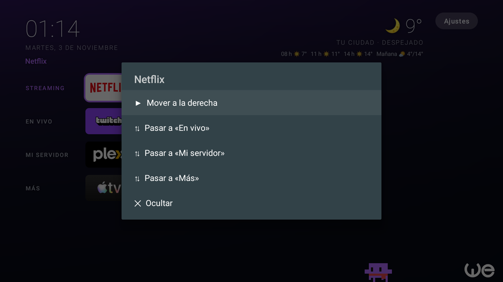
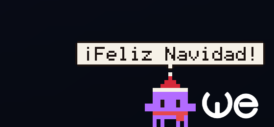
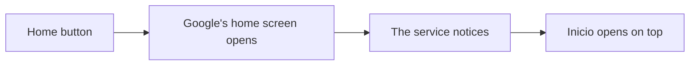

# Welan TV: a clean home screen for Google TV

**Less advertising, fewer pre-installed apps and a home screen of your own for your Google TV.**
No root needed, and nothing is permanently deleted.



> The on-screen text in the apps is in Spanish. "Inicio" means "Home".

## What's included

| | What it does |
|---|---|
| **Inicio** | A lightweight launcher with a clock, weather, wallpapers that change every hour, a night mode and named rows of apps |
| **Debloat list** | Removes 31 pre-installed apps from a TCL TV: advertising, usage statistics and things most people never open |
| **Screensaver** | Shows your own pictures and videos, with the weather on top |
| **Bichito** | A pixel pet that lives in the corner of the screen and gets up to mischief |
| **Tweaks** | Faster animations and an ad-blocking DNS |

Use all of it or just one part. Each piece works on its own.

## What it looks like

### Fully set up

With your apps installed and sorted, streaming, live video and your media server all fit on one screen, with no ads.



> The **Emuladores** and **Mi PC** rows come from a personal setup that streams games from a PC. They aren't included in this project, so you won't see them after installing. The apps themselves aren't included either.

### Your apps, your way

**Hold OK** on an app to open a menu where you can move it, send it to another row, hide it or uninstall it. No PC needed.



### Meet Bichito

It hops, dances, thinks out loud and follows the remote's arrows with its eyes. It also plays with the logo in the corner: it climbs on it, pushes it and carries it around.

| Says hello and dances | Giant mode |
|---|---|
|  |  |

It reacts to the weather and the calendar too:

| Takes cover from the rain | Fireworks on New Year's Eve |
|---|---|
|  |  |

| At Christmas | Asleep at night |
|---|---|
|  |  |

> There's a secret code for the remote: **up, up, down, down, left, right, left, right.**

These animations were captured frame by frame, so they look much smoother on the TV.

### The screensaver

It shows your pictures and videos for 20 seconds each, with the weather and Bichito on top. Without any files of your own, it uses this background:


## Before you start

- **Tested on one TV only:** a TCL with Google TV and Android 11. Other brands or versions may behave differently.
- **The debloat list is for TCL.** On other brands, most of those apps won't exist.
- **Use it at your own risk.** If something goes wrong, you can undo it with the scripts or a factory reset, which also erases your apps and settings.
- **A Google TV update could break something** that works today.
- **The scripts are new.** The apps and the debloat preview were tested on the TV, but `install.ps1`, `restore.ps1`, `uninstall.ps1` and `tweaks.ps1` have not been run on one yet.

## Installation

You need a Windows PC on the same network as the TV.

### 1. Enable debugging on the TV

1. Go to **Settings > System > About** and select **Android TV OS build** 7 times.
2. In **System > Developer options**, turn on **USB debugging**.
3. Note the TV's IP address, under **Settings > Network**.

Menu names may vary by TV. The first time you connect, a prompt appears on the TV: tick **Always allow** and accept.

### 2. Set up the PC

Install [Android Platform Tools](https://developer.android.com/tools/releases/platform-tools) (ADB), the [Android SDK](https://developer.android.com/studio#command-line-tools-only) with `build-tools;34.0.0` and `platforms;android-30`, and a [JDK 17](https://learn.microsoft.com/java/openjdk/download).

### 3. Build

```powershell
.\build.ps1
```

This creates `apk\Inicio.apk` and `apk\Protector.apk`, signed with a local key generated on your PC.

### 4. Install

```powershell
.\scripts\install.ps1 -Tv TV_IP_ADDRESS
```

To add the screensaver and your own files:

```powershell
.\scripts\install.ps1 -Tv TV_IP_ADDRESS -Screensaver -Wallpapers C:\path\to\pictures -Videos C:\path\to\videos
```

### 5. Debloat the TV (optional)

Check what would be removed first. Without `-Apply`, this command changes nothing:

```powershell
.\scripts\debloat.ps1 -Tv TV_IP_ADDRESS
```

The list is in [`scripts/apps-to-remove.txt`](scripts/apps-to-remove.txt). Delete any line to keep that app. [Here's what each one does](docs/DEBLOAT.md). When you're ready:

```powershell
.\scripts\debloat.ps1 -Tv TV_IP_ADDRESS -Apply
```

### 6. Speed and DNS tweaks (optional)

```powershell
.\scripts\tweaks.ps1 -Tv TV_IP_ADDRESS
```

## Undoing it

| To undo | Command |
|---|---|
| Bring the removed apps back | `.\scripts\restore.ps1 -Tv TV_IP_ADDRESS` |
| Remove Inicio and the screensaver | `.\scripts\uninstall.ps1 -Tv TV_IP_ADDRESS` |
| Go back to the normal settings | `.\scripts\tweaks.ps1 -Tv TV_IP_ADDRESS -Undo` |

## How it works

### Removing apps without root

`pm uninstall --user 0` removes an app **for your user**. It stops running, but the file stays in the system, so it doesn't free up storage and can be brought back.

### The Home button problem

Choosing another launcher isn't enough: Google TV re-enables its own at every boot, and the Home button opens it again. The fix is a small accessibility service:



The service **only watches Google's launcher** and can't read what's on the screen. You can check that in [`home_guard.xml`](launcher/res/xml/home_guard.xml).

There are two downsides: Google's home screen sometimes shows for an instant, and it keeps using some memory.

### The auto-start permission

TCL TVs stop sideloaded apps from starting on their own. Without this permission, the screensaver won't open even when it's selected in the settings. `install.ps1` grants it for you.

### After updating

Reinstalling Inicio disconnects the accessibility service, and Home goes back to opening Google's launcher. Run `install.ps1` again to reconnect it.

## Customizing

| To change | Where |
|---|---|
| Corner logo | Replace `logo.png` in `launcher/res/drawable-nodpi/` and `protector/res/drawable-nodpi/` |
| Default background | Replace `fondo.png` in the same folders |
| Rotating wallpapers | Copy them with `-Wallpapers`, or by hand to `/sdcard/Pictures/Fondos` |
| App rows | `DEFAULT_ROWS` in [`InicioActivity.java`](launcher/src/tv/inicio/launcher/InicioActivity.java) |
| Bichito's greeting and phrases | `HELLO` and `WORDS` in [`Bichito.java`](launcher/src/tv/inicio/launcher/Bichito.java) |

After changing anything, run `build.ps1` and `install.ps1` again.

## Privacy

- **No accounts or analytics:** the apps don't store or send usage data.
- **The weather uses the internet:** the TV asks [ipwho.is](https://ipwho.is) for its city once, which shares its IP address, and asks [Open-Meteo](https://open-meteo.com) for the forecast, using that city's coordinates.
- **The DNS is optional:** with `tweaks.ps1`, the TV's lookups go through [AdGuard DNS](https://adguard-dns.io).

## License and trademarks

The code is under the [MIT license](LICENSE). The "We" logo (`logo.png`) is not covered by that license, so replace it in anything you publish yourself. This project isn't affiliated with TCL, Google or any brand shown in the screenshots, which belong to their owners.

Built with help from Claude Code.
